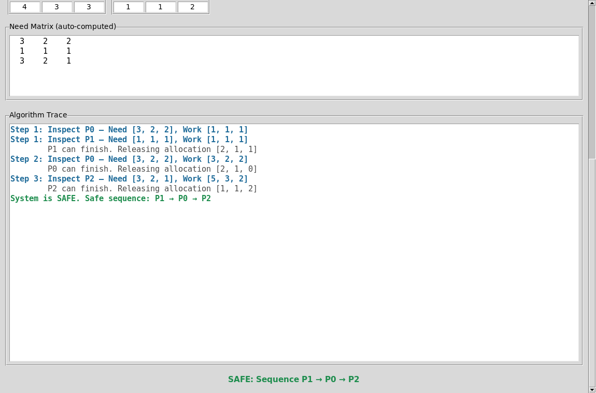

<p align="center">
  
</p>

<h1 align="center">Banker's Algorithm: Deadlock Prevention</h1>

<p align="center">A Python example of the Banker's Algorithm with a command-line interface and a Tkinter visualizer.</p>

<div align="center">

[Overview](#overview) · [Features](#features) · [Install](#install) · [Run](#run) · [Tests](#tests)

</div>

## Overview

The program calculates Need from the Max and Allocation matrices. It then checks if the system is safe. The result includes a safe sequence or an unsafe state.

## Features

- Load preset matrices or enter a custom system.
- View the calculated Need matrix and the safety trace in the GUI.
- Apply resource requests in the CLI. The program grants or denies each request.
- Edit Max, Allocation, and Available values in the GUI.

The GUI does not have resource-request controls. Use the CLI to make a request. The GUI displays a text trace. It does not animate the steps.

### Simple Safe example

The Simple Safe preset uses three processes and three resources. The lower view shows its Need matrix, trace, and SAFE sequence. The image does not show the preset controls or matrix labels.



## Install

The Banker module uses the Python standard library. Use `Python 3.10+` for this module. Use `Python 3.13+` for the root toolchain. The GUI uses Tkinter. Start it on a desktop display.

The `requirements.txt` file lists no external packages. Run the commands from the repository root.

## Run

Start the interactive command-line program:

```sh
python -m deadlock_prevention.bankers.cli
```

Start the Tkinter visualizer:

```sh
python deadlock_prevention/demo.py
```

The CLI loads two example systems. The GUI has preset safe and unsafe systems. Both programs let you run a safety check.

## Tests

Run the Banker tests from the repository root:

```sh
python -m unittest discover -s deadlock_prevention/tests
```

[Aventa Lumen Toolchain README](../README.md)
